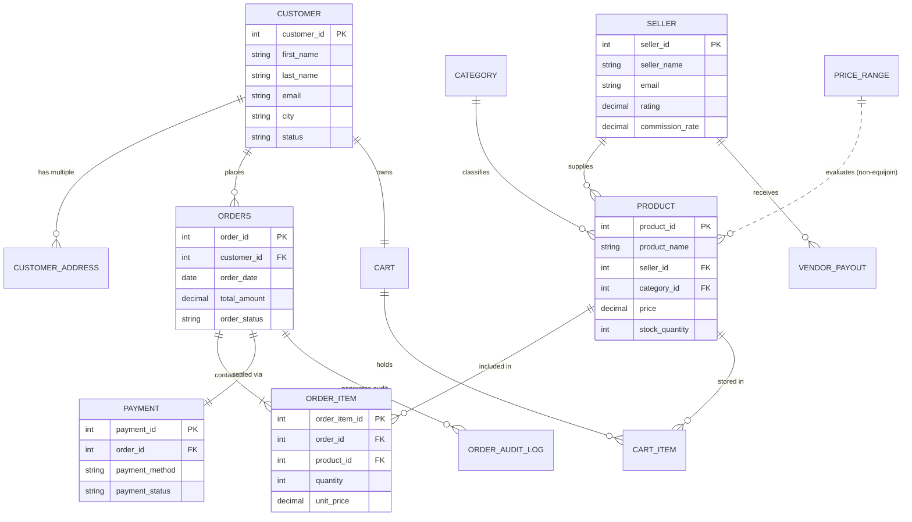

# Smart Multi-Vendor E-Commerce Order Management System
**Course Project (CP) — AI 2303: Database Management Systems**  
**Department of Artificial Intelligence & Data Science, VIT Pune (AY 2025-26)**  
**Student:** Devraj Bhagvat (PRN: 1251010374, Roll No: 06, Batch: B-1, SY AIDS-B)

---

## 1. Project Overview
The **Smart Multi-Vendor E-Commerce Order Management System** is a production-grade, relational database solution engineered strictly on **MySQL 8.0+** with an integrated modern light-themed Web Application built on **Python Flask** and **Vanilla Modern JavaScript**.

In modern e-commerce marketplaces (e.g., Amazon, Flipkart), multiple independent sellers list goods in shared or unique categories, and customers place orders that can span multiple vendors. This project manages:
* **Multi-Vendor Store Management**: Vendor registration, platform commission calculations, catalog listing, rating tracking.
* **Customer & Address Profiles**: Account maintenance, 1:M delivery address tracking, purchase history.
* **Catalog & Categories**: Multi-tiered pricing, stock inventory, dynamic discount structures.
* **Order Processing & Fulfillment**: ACID-compliant transactional order placement, order line items, payment settlement.
* **Database Automation**: MySQL Triggers for inventory decrement, negative-stock prevention, and status audit logging.
* **Programmability & Reconciliation**: MySQL Stored Procedures, Stored Functions, and Cursors for vendor sales summaries and batch payout distributions.

---

## 2. DBMS Syllabus & Lab Mapping Matrix

| Lab / Syllabus Requirement | Core DBMS Concept | Implementation in this CP | Script / Location |
| :--- | :--- | :--- | :--- |
| **Lab 1: Requirement Analysis & ER Model** | Conceptual design, entities, attributes, relationships, cardinalities | Full relational ER design with 1:1, 1:M, and M:N relationships | `database/01_schema_ddl.sql` |
| **Lab 2: DDL & DML Schema Definition** | CREATE, ALTER, DROP, TRUNCATE, constraints (PK, FK, UNIQUE, CHECK, DEFAULT, NOT NULL) | Complete schema creation, referential integrity with ON DELETE CASCADE / RESTRICT | `database/01_schema_ddl.sql`, `database/02_sample_dml.sql` |
| **Lab 3: DQL Queries & Operators** | WHERE operators (AND, OR, NOT, LIKE, IN, BETWEEN, IS NULL), ORDER BY, GROUP BY, HAVING, single-row functions (date, math, string), Set operations (UNION, INTERSECT, MINUS) | Business queries, pricing analytics, regional delivery filters, string formatting, date differences | `database/03_queries_dql.sql` |
| **Lab 4: Joins & Subqueries** | Equijoin, non-equijoin, self-join, inner join, outer joins, single/multi/correlated subqueries, DML with subqueries | Vendor catalog tracing, price-range banding (`Price_Range`), same-city customer pairs, category-relative price checks | `database/04_joins.sql`, `database/05_subqueries.sql` |
| **Lab 5: PL/SQL & MySQL Cursors** | Explicit cursors, OPEN, FETCH, CLOSE, NOT FOUND handler, cursor loops, parameterized cursors, updates | Batch vendor sales reconciliation & payout generation (`calculate_vendor_payouts_cursor`), stock alerts | `database/06_cursors.sql` |
| **Lab 6: Stored Procedures & Functions** | Parameterized stored routines, control flow, transactions (`START TRANSACTION`, `COMMIT`, `ROLLBACK`) | Atomic checkout procedure (`place_order_procedure`), order cancellation (`cancel_order_procedure`), order subtotal function | `database/07_procedures.sql`, `database/08_functions.sql` |
| **Lab 7: Database Triggers** | BEFORE/AFTER INSERT, UPDATE, DELETE row-level triggers, data integrity validation, audit trail | Automatic stock reduction, negative inventory prevention, order state transition audit log | `database/09_triggers.sql` |
| **Lab 8: Views & Updatable Views** | Complex multi-table views, updatable views with `WITH CHECK OPTION` | 5-table joined order fulfillment view (`view_order_details`), category-restricted view (`view_active_electronics`) | `database/10_views_and_indexing.sql` |
| **Unit 5: Query Processing & Indexing** | B-Tree indexing, execution plan analysis, index selectivity, cost-based optimization | Indexes on `price`, `order_date`, composite indexes, `EXPLAIN` analysis | `database/10_views_and_indexing.sql` |

---

## 3. Relational Schema Architecture

```text
Customer(customer_id [PK], first_name, last_name, email [UQ], phone [UQ], registration_date, city, status)
Seller(seller_id [PK], seller_name, email [UQ], phone [UQ], city, rating, commission_rate, registration_date, status)
Category(category_id [PK], category_name [UQ], description)
Product(product_id [PK], product_name, seller_id [FK], category_id [FK], price, stock_quantity, product_rating, added_date, discount_percent)
Customer_Address(address_id [PK], customer_id [FK], address_line, city, state, pincode, is_default)
Orders(order_id [PK], customer_id [FK], order_date, total_amount, order_status)
Order_Item(order_item_id [PK], order_id [FK], product_id [FK], quantity, unit_price)
Payment(payment_id [PK], order_id [FK, UQ], payment_date, payment_method, payment_status)
Cart(cart_id [PK], customer_id [FK, UQ], created_date)
Cart_Item(cart_item_id [PK], cart_id [FK], product_id [FK], quantity)
Price_Range(range_id [PK], range_name, minimum_price, maximum_price)
Order_Audit_Log(log_id [PK], order_id, old_status, new_status, changed_at, action_type)
Vendor_Payout(payout_id [PK], seller_id [FK], total_sales, commission_deducted, net_payout, payout_date)
```

---

## 4. Entity-Relationship (ER) Model



---

## 5. Folder & Project Structure
```text
smart-multivendor-ecommerce/
│
├── database/
│   ├── 01_schema_ddl.sql           # DDL: Tables, PKs, FKs, CHECK, UNIQUE, NOT NULL
│   ├── 02_sample_dml.sql           # DML: Realistic dataset for multi-vendor operations
│   ├── 03_queries_dql.sql          # DQL: Relational operators, grouping, aggregation, functions
│   ├── 04_joins.sql                # Equijoin, non-equijoin, self-join, outer joins
│   ├── 05_subqueries.sql           # Single, multi-row (IN/ANY/ALL), correlated (EXISTS)
│   ├── 06_cursors.sql              # Cursors for payout reconciliation & loops
│   ├── 07_procedures.sql           # ACID Stored Procedures (Checkout, Cancellation)
│   ├── 08_functions.sql            # Stored Functions (Subtotal, Discount, Commission)
│   ├── 09_triggers.sql             # Triggers: Stock reduction, integrity, audit log
│   └── 10_views_and_indexing.sql   # Indexes, EXPLAIN analysis, Updatable Views
│
├── backend/
│   ├── config.py                   # DB host, port, credentials configuration
│   ├── db.py                       # MySQL connection pooling & execution helpers
│   ├── init_db.py                  # Automated execution runner for all SQL files
│   └── app.py                      # Flask RESTful API server
│
├── frontend/
│   ├── templates/
│   │   └── index.html              # Modern, light-themed admin dashboard
│   └── static/
│       ├── css/                    # Custom CSS styling
│       └── js/
│           └── app.js              # Real-time UI data synchronization & API controller
│
└── README.md                       # Comprehensive project & viva documentation
```

---

## 6. How to Run the Project

### Prerequisites
1. **MySQL Server 8.0+** running on port 3306.
2. **Python 3.10+** and: `pip install flask mysql-connector-python`

### Step 1: Configure secrets (never commit these)
Copy `.env.example` to `.env` and fill in your MySQL password and a random `SECRET_KEY`.

### Step 2: Build the database and demo logins
```bash
python -m backend.init_db       # WARNING: drops and recreates ecommerce_db
python -m backend.seed_users    # creates demo logins for the sample data
```

### Step 3: Start the app
```bash
python backend/app.py
```
Open http://127.0.0.1:5000 - it redirects to the right login page.

| Portal | URL | Demo login (demo passwords only) |
| :--- | :--- | :--- |
| Customer | `/login` | any customer email in the sample data / `Customer@123` |
| Vendor | `/vendor/login` | any seller email in the sample data / `Vendor@123` |
| Admin | `/admin/login` | `admin@smartstore.com` / `Admin@123` |

New customers can sign up at `/register`. New vendors sign up at `/vendor/register` and stay **Pending** until an admin approves them.

---

## 7. Viva Voce Preparation & Technical Q&A

### Q1: Why did you choose MySQL for this Course Project?
> **Answer:** MySQL is an enterprise-grade open-source RDBMS that strictly implements the ANSI SQL standard, provides transactional ACID compliance with InnoDB storage engine, supports row-level locking, foreign key integrity, row-level triggers, explicit cursors, and stored routines.

### Q2: What is the difference between Equijoin and Non-Equijoin? Give an example from your project.
> **Answer:** 
> * An **Equijoin** uses the equality operator (`=`) to match rows between tables based on common keys (e.g., joining `Product.seller_id = Seller.seller_id`).
> * A **Non-Equijoin** uses comparison operators other than equality (`BETWEEN`, `<`, `>`, `<=`, `>=`). In our project, we join `Product` with `Price_Range` using `ON Product.price BETWEEN Price_Range.minimum_price AND Price_Range.maximum_price` to classify products into economic price bands without hardcoding.

### Q3: How did you implement Full Outer Join in MySQL since MySQL does not support the `FULL OUTER JOIN` keyword?
> **Answer:** MySQL does not natively support `FULL OUTER JOIN`. We emulate it using standard relational algebra: a `LEFT OUTER JOIN` unioned with a `RIGHT OUTER JOIN` via the `UNION` set operator, which automatically eliminates duplicate tuples.

### Q4: Explain the role and execution lifecycle of a MySQL Cursor in your system.
> **Answer:** 
> A cursor allows tuple-at-a-time (row-by-row) retrieval and manipulation of query result sets. Its lifecycle consists of:
> 1. `DECLARE cur_name CURSOR FOR <SELECT query>`
> 2. `DECLARE CONTINUE HANDLER FOR NOT FOUND SET done = 1`
> 3. `OPEN cur_name`
> 4. `FETCH cur_name INTO <variables>` within a `LOOP` construct
> 5. `CLOSE cur_name`
> In our project, `calculate_vendor_payouts_cursor()` iterates over each active vendor, computes total sales from delivered order line items, calculates platform commission, and inserts a reconciled payout record into `Vendor_Payout`.

### Q5: How do Triggers maintain data integrity in this system?
> **Answer:** 
> We implemented three essential triggers:
> 1. `AFTER INSERT ON Order_Item`: Automatically decrements `Product.stock_quantity` whenever an order item is purchased.
> 2. `BEFORE UPDATE ON Product`: Checks if `NEW.stock_quantity < 0`. If true, it invokes `SIGNAL SQLSTATE '45000'` with an error message, preventing negative inventory at the database level.
> 3. `AFTER UPDATE ON Orders`: Detects when `OLD.order_status <> NEW.order_status` and logs the transition into `Order_Audit_Log` with timestamps.

### Q6: How does your Stored Procedure ensure ACID properties during Checkout?
> **Answer:** 
> In `place_order_procedure()`, we execute `START TRANSACTION`. It performs customer status checks, stock availability validation, inserts into `Orders`, inserts line items into `Order_Item`, updates inventory, and creates a `Payment` record. If any step fails or an SQLEXCEPTION occurs, the exit handler executes `ROLLBACK`, guaranteeing **Atomicity and Consistency**. If all succeed, it calls `COMMIT` to ensure **Durability**.
